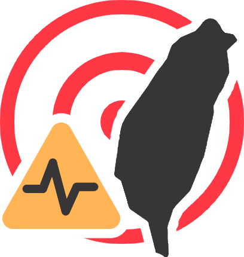

<div align="center">



# Tighnari-SeisLOC

**Automatic earthquake location and waveform observatory for the Taiwan region, built on public seismic data.**

[](https://github.com/taiwanerg/Tighnari-SeisLOC/actions/workflows/checks.yml)
[](LICENSE)


English · [繁體中文](README.zh-TW.md)

[線上即時展示](https://tighnari.kuuchi.idv.tw/)

</div>

Tighnari-SeisLOC receives live waveforms from public stations, picks P and S
arrivals with PhaseNet, and estimates **epicenter, depth, origin time and local
magnitude (ML)** for earthquakes near Taiwan. A local web dashboard shows the
waveforms, event records and every revision of each solution.

> [!IMPORTANT]
> Results are automatic estimates for research and education. They are **not**
> official earthquake reports and this system does **not** provide earthquake
> early warning. For official information, see the
> [Central Weather Administration](https://www.cwa.gov.tw/).

## Features

| | |
|---|---|
| **Live location** | EarthScope SeedLink waveforms → PhaseNet picks → association → 1-D location with depth profile and A–D quality grade |
| **Magnitude** | Taiwan Wood–Anderson ML; independent teleseismic Mwp as a background task |
| **Web dashboard** | Waveforms, phase residuals, depth diagnostics, magnitude rejection reasons, map/JSON export, statistics at `/records` |
| **Notifications** | Optional Discord webhook reports for events with a finite ML |
| **Review** | Admin console at `/hoshi`: confirm events, override ML, annotate, flag or restore |
| **Mechanisms** *(experimental)* | P-wave first-motion solutions from GDMS waveforms; regional CMT / CAP and W-phase research tools |

## Quick start

Requires Python 3.11–3.13 and internet access (live data and model download).
Inference runs on the CPU.

```bash
git clone https://github.com/taiwanerg/Tighnari-SeisLOC.git
cd Tighnari-SeisLOC
python -m venv .venv
.venv/bin/python -m pip install -e ".[ml]"
.venv/bin/python -m tighnari_seisloc setup-models   # download pinned PhaseNet weights
.venv/bin/python start.py
```

Open <http://127.0.0.1:8765> and press `Ctrl+C` to stop.
On Windows, use `.venv\Scripts\python.exe` instead of `.venv/bin/python`, or `run.bat` with conda.

## Configuration

Copy `.env.example` to `.env` and edit it; process environment variables take
precedence. Commonly used settings:

| Variable | Purpose |
|---|---|
| `TIGHNARI_DISCORD_WEBHOOK` | Discord webhook URL(s) for event reports |
| `TIGHNARI_PUBLIC_URL` | Public origin used for canonical URLs, sitemaps and report links |
| `TIGHNARI_MAX_STATIONS` | Maximum number of stations analysed (1–60) |
| `TIGHNARI_EXCLUDED_CHANNELS` | Channels to ignore, e.g. `TW.KNM.10.EH` |
| `TIGHNARI_GDMS_AUTO_DOWNLOAD` | Enable post-event GDMS waveform downloads |
| `TIGHNARI_REGIONAL_CMT_ENABLED` | Enable the experimental regional moment-tensor task |

## Optional extras

| Extra | Installs | Used for |
|---|---|---|
| `ml` | SeisBench, PyTorch | PhaseNet picking (needed for live location) |
| `gdms-edge` | Selenium | Microsoft Edge window for manual GDMS login |
| `cmt` | Pyrocko | Regional CMT, CAP and Green's function tools |
| `dev` | Ruff, build | Linting and packaging |

GDMS manual login, regional CMT, CAP and W-phase workflows are documented in the
[advanced guide](ADVANCED.zh-TW.md) (Traditional Chinese).

## Command line

```text
tighnari-seisloc serve               Start the observatory (same as start.py)
tighnari-seisloc setup-models        Download pinned PhaseNet weights
tighnari-seisloc cmt-build-greens    Pre-compute Taiwan regional Green's functions
tighnari-seisloc cmt-replay          Replay a regional CMT inversion offline
tighnari-seisloc cmt-benchmark       Compare regional CMT results with catalogues
tighnari-seisloc wphase-replay       Run Geoscience Australia's W-phase solver offline
```

Research and maintenance scripts are in [`scripts/`](scripts/).

## Project layout

```text
src/tighnari_seisloc/
├── acquisition/   Data sources: EarthScope/FDSN, GDMS, BATS, Green's functions
├── processing/    Picking, association, location, magnitude, focal mechanisms, CMT
├── services/      Web app, monitor loop, storage, reports, notifications, admin
├── web/           Dashboard front end
└── legacy/        Earlier SAIU locator, kept for comparison
scripts/           Replay, validation and GDMS control tools
research/          Archived research summaries
```

## Limitations

- Quality grades A–D describe solution stability; they are **not** probabilities.
- Mwp is computed separately from ML and is not a USGS moment-tensor magnitude.
- ML saturates above about 6.5; such events are flagged.
- Public station availability changes over time. BATS enrichment is disabled by
  default while its FDSN service is unavailable (checked 2026-11-22).
- Focal mechanisms and CMT solutions are experimental and are shown only after
  quality gates pass.

## References

### Methods

- **PhaseNet** — Zhu, W., & Beroza, G. C. (2019). PhaseNet: a deep-neural-network-based seismic arrival-time picking method. *Geophys. J. Int.*, 216(1), 261–273. [doi:10.1093/gji/ggy423](https://doi.org/10.1093/gji/ggy423)
- **Taiwan ML** — Shin, T.-C. (1993). The calculation of local magnitude from the simulated Wood-Anderson seismograms of the short-period seismograms in the Taiwan area. *Terr. Atmos. Ocean. Sci.*, 4(2), 155–170.
- **Taiwan ML attenuation** — Guan et al. (2020). *Terr. Atmos. Ocean. Sci.* [PDF](https://tao.cgu.org.tw/index.php/articles/archive/geophysics/item/download/3503_b2cfcc500986ab6f55e3099d245cde2a)
- **Wood–Anderson magnification** — Wu et al. [PDF](https://scholars.lib.ntu.edu.tw/bitstreams/4e6cdc4c-3ebd-453e-a200-8f40d0e9b781/download)
- **Horizontal amplitude combination** — Lin et al. [doi:10.1007/s44195-026-00136-x](https://doi.org/10.1007/s44195-026-00136-x)
- **Mwp** — Tsuboi, S., Abe, K., Takano, K., & Yamanaka, Y. (1995). Rapid determination of Mw from broadband P waveforms. *Bull. Seismol. Soc. Am.*, 85(2), 606–613; Hirshorn et al. (2019), [earthquake source parameters, pp. 12–13](https://rctwg.humboldt.edu/sites/default/files/hirshorn2019_earthquakesourceparameters.pdf)
- **Taiwan 1-D velocity model** — Wu, Y.-M., et al. (2007). *J. Geophys. Res.*, 112, B08312. [doi:10.1029/2007JB004983](https://doi.org/10.1029/2007JB004983)
- **Travel times** — Kennett, B. L. N., & Engdahl, E. R. (1991). Traveltimes for global earthquake location and phase identification. *Geophys. J. Int.*, 105(2), 429–465 (iasp91, computed with ObsPy TauP)
- **First-motion quality** — Hardebeck, J. L., & Shearer, P. M. (2002). A new method for determining first-motion focal mechanisms. *Bull. Seismol. Soc. Am.*, 92(6), 2264–2276 (HASH); SKHASH is used for offline cross-checks
- **Mechanism comparison** — Kagan, Y. Y. (1991). 3-D rotation of double-couple earthquake sources. *Geophys. J. Int.*, 106(3), 709–716
- **Cut-and-Paste (CAP)** — Zhu, L., & Helmberger, D. V. (1996). Advancement in source estimation techniques using broadband regional seismograms. *Bull. Seismol. Soc. Am.*, 86(5), 1634–1641; segmented time shifts after [doi:10.1029/2005JB003775](https://doi.org/10.1029/2005JB003775)
- **RMT grid inversion and centroid search** — [doi:10.1093/gji/ggt371](https://doi.org/10.1093/gji/ggt371), [doi:10.1029/2011JB008501](https://doi.org/10.1029/2011JB008501)
- **W-phase** — Kanamori, H., & Rivera, L. (2008). Source inversion of W phase. *Geophys. J. Int.*, 175(1), 222–238; [ga-wphase](https://github.com/GeoscienceAustralia/ga-wphase)
- **Green's functions** — Wang, R. (1999). *Bull. Seismol. Soc. Am.*, 89(3), 733–741 ([QSEIS](https://git.pyrocko.org/pyrocko/fomosto-qseis)); [Pyrocko global stores](https://gf.pyrocko.org/gfws/static/stores/global_20s_shallow/)
- **Design references** (independent implementations) — [Early-est](https://doi.org/10.5194/nhess-15-2019-2015), [FilterPicker](https://doi.org/10.1785/gssrl.83.3.531), [GlobalQuake](https://github.com/xspanger3770/GlobalQuake)

### Data

- [EarthScope / IRIS](https://www.earthscope.org/data/terms-and-conditions/) — SeedLink and FDSN waveforms and StationXML. Please cite the individual networks, e.g. [TW](https://www.fdsn.org/networks/detail/TW/), [TQ](https://www.fdsn.org/networks/detail/TQ/), [IU](https://www.fdsn.org/networks/detail/IU/), [JP](https://www.fdsn.org/networks/detail/JP/), [KG](https://www.fdsn.org/networks/detail/KG/)
- [GDMS](https://gdms.cwa.gov.tw/), Central Weather Administration — post-event waveforms (account required)
- [BATS](https://bats.earth.sinica.edu.tw/), Institute of Earth Sciences, Academia Sinica — broadband archive
- [GEOFON](https://geofon.gfz.de/), GFZ — archived waveforms
- [NLSC](https://maps.nlsc.gov.tw/pro/download.jsp) town boundaries — Government Data Open License v1.0
- [Natural Earth](https://www.naturalearthdata.com/) — public domain

### Software

[SeisBench](https://github.com/seisbench/seisbench) ·
[ObsPy](https://github.com/obspy/obspy) ·
[Pyrocko](https://pyrocko.org/) ·
[PyTorch](https://pytorch.org/) ·
[NumPy](https://numpy.org/) ·
[SciPy](https://scipy.org/) ·
[FastAPI](https://fastapi.tiangolo.com/) ·
[Uvicorn](https://www.uvicorn.org/) ·
[HTTPX](https://www.python-httpx.org/) ·
[Pillow](https://python-pillow.org/) ·
[Shapely](https://github.com/shapely/shapely) ·
[pyproj](https://github.com/pyproj4/pyproj) ·
[Selenium](https://github.com/SeleniumHQ/selenium) ·
[Noto Sans TC](https://fonts.google.com/noto/specimen/Noto+Sans+TC)

## Citation

If you use Tighnari-SeisLOC in research, please cite this repository (see
[CITATION.cff](CITATION.cff)) together with the methods and data sources above.

## License

Tighnari-SeisLOC is released under the [GNU Affero General Public License v3.0 only](LICENSE).
Third-party code, model weights, fonts, map data and the TWERG logo keep their own
terms; see [THIRD_PARTY_NOTICES.md](THIRD_PARTY_NOTICES.md). TWERG logo are not covered by the AGPL.
