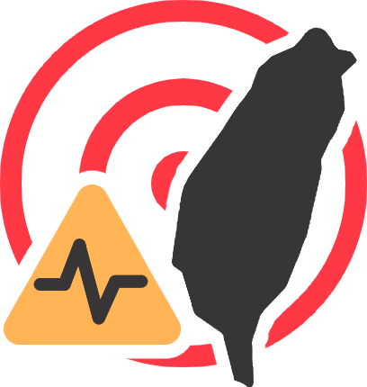

<div align="center">



# Tighnari-SeisLOC

**以公開地震測站資料為基礎的臺灣地區自動地震定位系統。**

[](https://github.com/taiwanerg/Tighnari-SeisLOC/actions/workflows/checks.yml)
[](LICENSE)


[English](README.md) · 繁體中文

</div>

Tighnari-SeisLOC 接收公開測站的即時波形，以 PhaseNet 挑選 P、S 波到時，
估算臺灣附近地震的**震央、深度、發震時間與芮氏規模（ML）**。
本地網站顯示測站波形、地震紀錄以及每一次定位修訂。

> [!IMPORTANT]
> 結果為供研究與教育使用的自動估算，**不是**官方地震報告，本系統也**不**提供地震預警。
> 官方地震資訊請以[中央氣象署](https://www.cwa.gov.tw/)為準。

## 功能

| | |
|---|---|
| **即時定位** | EarthScope SeedLink 波形 → PhaseNet 到時 → 事件關聯 → 一維模型定位，附深度剖面與 A–D 品質等級 |
| **規模** | 臺灣 Wood–Anderson ML；遠震 Mwp 由獨立背景工作計算 |
| **網站** | 波形、相位殘差、深度診斷、規模拒收原因、定位圖／JSON 下載，`/records` 統計與震央分布 |
| **通知** | 選用的 Discord Webhook，為具有效 ML 的事件發送報告 |
| **人工覆核** | `/hoshi` 管理後台：確認事件、修訂 ML、加註解、標記錯誤或還原 |
| **震源機制**（實驗性） | 以 GDMS 波形計算 P 波初動解；區域 CMT／CAP 與 W-phase 研究工具 |

## 快速開始

需要 Python 3.11–3.13 與網路連線（即時資料與模型下載），模型以 CPU 推論。

```bash
git clone https://github.com/taiwanerg/Tighnari-SeisLOC.git
cd Tighnari-SeisLOC
python -m venv .venv
.venv/bin/python -m pip install -e ".[ml]"
.venv/bin/python -m tighnari_seisloc setup-models   # 下載固定版本 PhaseNet 權重
.venv/bin/python start.py
```

開啟 <http://127.0.0.1:8765>，按 `Ctrl+C` 停止。
Windows 請將 `.venv/bin/python` 換成 `.venv\Scripts\python.exe`；使用 conda 時可執行 `run.bat`。

## 設定

將 `.env.example` 複製為 `.env` 後修改；系統環境變數優先於 `.env`。常用設定：

| 變數 | 用途 |
|---|---|
| `TIGHNARI_DISCORD_WEBHOOK` | 地震報告使用的 Discord Webhook（可多個） |
| `TIGHNARI_PUBLIC_URL` | 對外網址，用於正式網址、Sitemap 與報告連結 |
| `TIGHNARI_MAX_STATIONS` | 分析測站數上限（1–60） |
| `TIGHNARI_EXCLUDED_CHANNELS` | 排除的頻道，例如 `TW.KNM.10.EH` |
| `TIGHNARI_GDMS_AUTO_DOWNLOAD` | 啟用震後 GDMS 波形自動下載 |
| `TIGHNARI_REGIONAL_CMT_ENABLED` | 啟用實驗性區域矩張量試算 |

## 選用套件

| Extra | 安裝內容 | 用途 |
|---|---|---|
| `ml` | SeisBench、PyTorch | PhaseNet 到時挑選（即時定位必要） |
| `gdms-edge` | Selenium | 開啟 Microsoft Edge 視窗手動登入 GDMS |
| `cmt` | Pyrocko | 區域 CMT、CAP 與格林函數工具 |
| `dev` | Ruff、build | 程式檢查與打包 |

GDMS 手動登入、區域 CMT、CAP 及 W-phase 流程請見[進階功能指南](ADVANCED.zh-TW.md)。

## 命令列

```text
tighnari-seisloc serve               啟動監看系統（等同 start.py）
tighnari-seisloc setup-models        下載固定版本 PhaseNet 權重
tighnari-seisloc cmt-build-greens    預算臺灣區域格林函數
tighnari-seisloc cmt-replay          離線重播區域 CMT 反演
tighnari-seisloc cmt-benchmark       比較區域 CMT 與目錄解
tighnari-seisloc wphase-replay       以 GA W-phase 離線反演長週期矩張量
```

研究與維運腳本位於 [`scripts/`](scripts/)。

## 專案結構

```text
src/tighnari_seisloc/
├── acquisition/   資料來源：EarthScope/FDSN、GDMS、BATS、格林函數
├── processing/    到時、關聯、定位、規模、震源機制、CMT
├── services/      網站、監看迴圈、儲存、報告、通知、管理後台
├── web/           前端頁面
└── legacy/        早期 SAIU 定位器，保留作比較
scripts/           重播、驗證與 GDMS 控制工具
research/          封存的研究摘要
```

## 使用限制

- A–D 品質等級描述解的穩定度。
- Mwp 與 ML 分開計算，此數值不是 USGS 的矩張量規模。
- ML 約 6.5 以上會飽和，系統會加註提醒。
- 公開測站可用性會變動。BATS FDSN 服務不可用期間，BATS 補強預設停用（2026-11-22 驗證）。
- 震源機制與 CMT 解為實驗性結果，通過品質門檻才會顯示。

## 參考資料

### 方法

- **PhaseNet** — Zhu, W., & Beroza, G. C. (2019). PhaseNet: a deep-neural-network-based seismic arrival-time picking method. *Geophys. J. Int.*, 216(1), 261–273. [doi:10.1093/gji/ggy423](https://doi.org/10.1093/gji/ggy423)
- **臺灣 ML** — Shin, T.-C. (1993). The calculation of local magnitude from the simulated Wood-Anderson seismograms of the short-period seismograms in the Taiwan area. *Terr. Atmos. Ocean. Sci.*, 4(2), 155–170.
- **臺灣 ML 衰減式** — Guan et al. (2020). *Terr. Atmos. Ocean. Sci.* [PDF](https://tao.cgu.org.tw/index.php/articles/archive/geophysics/item/download/3503_b2cfcc500986ab6f55e3099d245cde2a)
- **Wood–Anderson 倍率** — Wu et al. [PDF](https://scholars.lib.ntu.edu.tw/bitstreams/4e6cdc4c-3ebd-453e-a200-8f40d0e9b781/download)
- **水平振幅合成** — Lin et al. [doi:10.1007/s44195-026-00136-x](https://doi.org/10.1007/s44195-026-00136-x)
- **Mwp** — Tsuboi, S., Abe, K., Takano, K., & Yamanaka, Y. (1995). Rapid determination of Mw from broadband P waveforms. *Bull. Seismol. Soc. Am.*, 85(2), 606–613；Hirshorn et al. (2019)，[earthquake source parameters, pp. 12–13](https://rctwg.humboldt.edu/sites/default/files/hirshorn2019_earthquakesourceparameters.pdf)
- **臺灣一維速度模型** — Wu, Y.-M., et al. (2007). *J. Geophys. Res.*, 112, B08312. [doi:10.1029/2007JB004983](https://doi.org/10.1029/2007JB004983)
- **走時** — Kennett, B. L. N., & Engdahl, E. R. (1991). Traveltimes for global earthquake location and phase identification. *Geophys. J. Int.*, 105(2), 429–465（iasp91，以 ObsPy TauP 計算）
- **初動解品質** — Hardebeck, J. L., & Shearer, P. M. (2002). A new method for determining first-motion focal mechanisms. *Bull. Seismol. Soc. Am.*, 92(6), 2264–2276（HASH）；離線交叉比對使用 SKHASH
- **機制比較** — Kagan, Y. Y. (1991). 3-D rotation of double-couple earthquake sources. *Geophys. J. Int.*, 106(3), 709–716
- **CAP 分段波形反演** — Zhu, L., & Helmberger, D. V. (1996). Advancement in source estimation techniques using broadband regional seismograms. *Bull. Seismol. Soc. Am.*, 86(5), 1634–1641；分段時移參考 [doi:10.1029/2005JB003775](https://doi.org/10.1029/2005JB003775)
- **RMT 網格反演與水平矩心搜尋** — [doi:10.1093/gji/ggt371](https://doi.org/10.1093/gji/ggt371)、[doi:10.1029/2011JB008501](https://doi.org/10.1029/2011JB008501)
- **W-phase** — Kanamori, H., & Rivera, L. (2008). Source inversion of W phase. *Geophys. J. Int.*, 175(1), 222–238；[ga-wphase](https://github.com/GeoscienceAustralia/ga-wphase)
- **格林函數** — Wang, R. (1999). *Bull. Seismol. Soc. Am.*, 89(3), 733–741（[QSEIS](https://git.pyrocko.org/pyrocko/fomosto-qseis)）；[Pyrocko 全球波形庫](https://gf.pyrocko.org/gfws/static/stores/global_20s_shallow/)
- **設計參考**（獨立實作）— [Early-est](https://doi.org/10.5194/nhess-15-2019-2015)、[FilterPicker](https://doi.org/10.1785/gssrl.83.3.531)、[GlobalQuake](https://github.com/xspanger3770/GlobalQuake)

### 資料

- [EarthScope / IRIS](https://www.earthscope.org/data/terms-and-conditions/) — SeedLink、FDSN 波形與 StationXML。引用時請註明各測站網，例如 [TW](https://www.fdsn.org/networks/detail/TW/)、[TQ](https://www.fdsn.org/networks/detail/TQ/)、[IU](https://www.fdsn.org/networks/detail/IU/)、[JP](https://www.fdsn.org/networks/detail/JP/)、[KG](https://www.fdsn.org/networks/detail/KG/)
- 中央氣象署 [GDMS](https://gdms.cwa.gov.tw/) — 震後波形（需帳號）
- 中央研究院地球科學研究所 [BATS](https://bats.earth.sinica.edu.tw/) — 寬頻地震資料庫
- GFZ [GEOFON](https://geofon.gfz.de/) — 封存波形
- 國土測繪中心 [NLSC](https://maps.nlsc.gov.tw/pro/download.jsp) 鄉鎮界 — 政府資料開放授權條款第 1 版
- [Natural Earth](https://www.naturalearthdata.com/) — 公有領域

### 軟體

[SeisBench](https://github.com/seisbench/seisbench) ·
[ObsPy](https://github.com/obspy/obspy) ·
[Pyrocko](https://pyrocko.org/) ·
[PyTorch](https://pytorch.org/) ·
[NumPy](https://numpy.org/) ·
[SciPy](https://scipy.org/) ·
[FastAPI](https://fastapi.tiangolo.com/) ·
[Uvicorn](https://www.uvicorn.org/) ·
[HTTPX](https://www.python-httpx.org/) ·
[Pillow](https://python-pillow.org/) ·
[Shapely](https://github.com/shapely/shapely) ·
[pyproj](https://github.com/pyproj4/pyproj) ·
[Selenium](https://github.com/SeleniumHQ/selenium) ·
[Noto Sans TC](https://fonts.google.com/noto/specimen/Noto+Sans+TC)

## 引用

若在研究中使用 Tighnari-SeisLOC，請引用本專案（見 [CITATION.cff](CITATION.cff)），並一併引用上列方法與資料來源。

## 授權

本專案程式碼採用 [GNU Affero General Public License v3.0 only](LICENSE)。
第三方程式、模型權重、字型、地圖資料與 TWERG 標誌各自保留原授權，詳見
[THIRD_PARTY_NOTICES.md](THIRD_PARTY_NOTICES.md)。地牛記錄小組和 TWERG
（Taiwan Earthquake Recording Group）的 Logo 不在 AGPL 授權範圍內。
